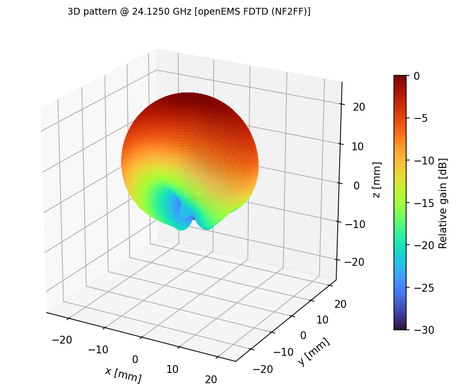
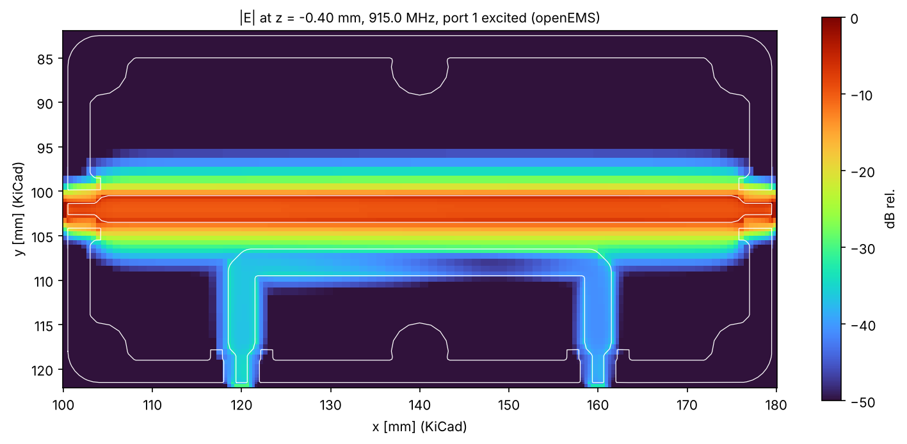
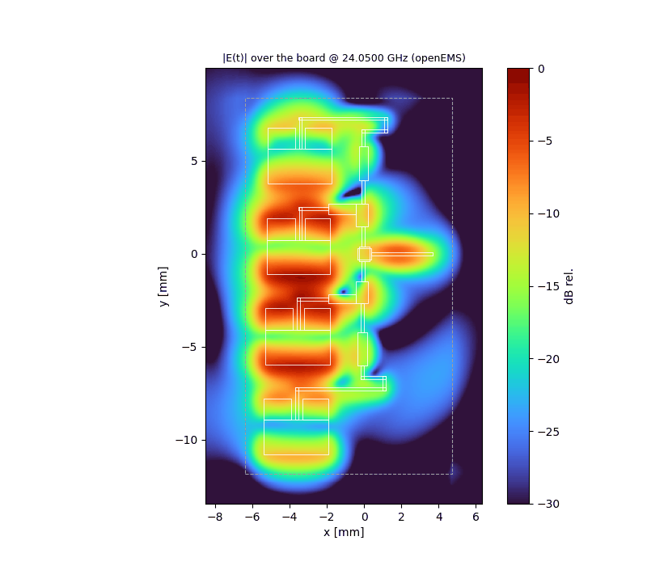
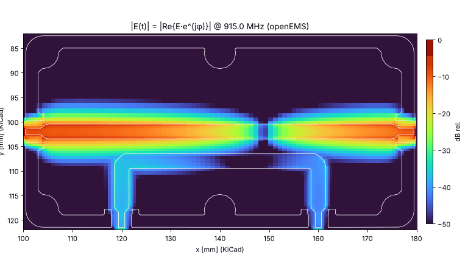
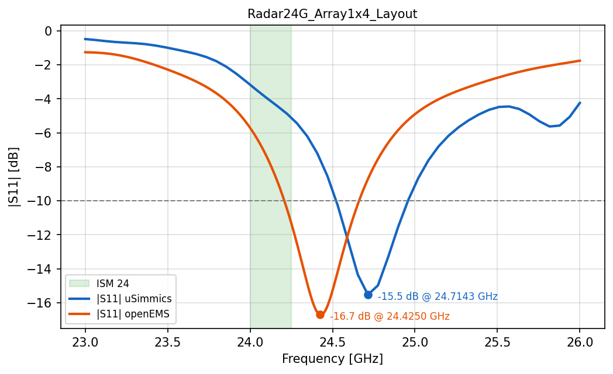
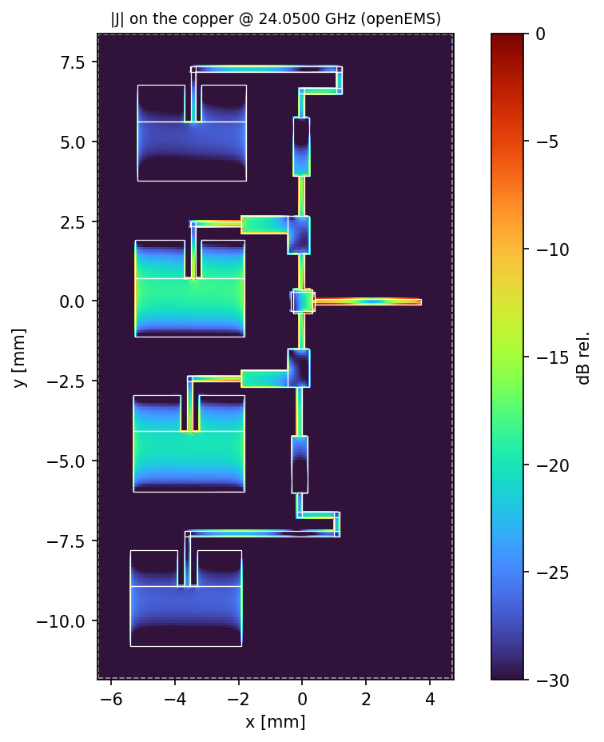
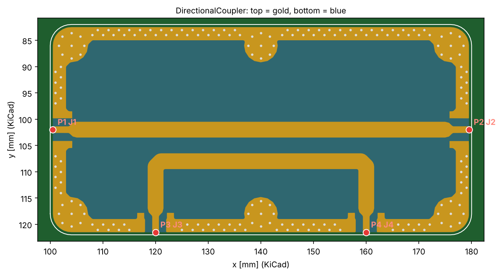
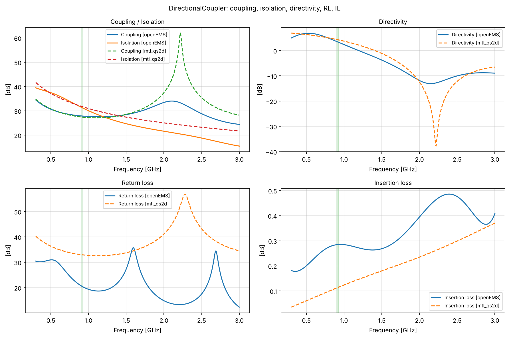

# qucs-em-viz

**EM simulation and visualization toolkit for RF structures on PCB: uSimmics / QucsStudio projects, KiCad boards and openEMS.**

Three independent scripts share one Python package (`qemviz/`). Each one solves a different problem in the design flow of an antenna or RF circuit on a PCB, from a 2D estimate in seconds to a full-wave 3D simulation of the board as manufactured.

<p align="center">
  
  
</p>
<p align="center">
  
  
</p>

*Left: 1×4 patch array of the HLK-LD2411 24 GHz radar (uSimmics flow). Right: 902–928 MHz directional coupler on FR4 (KiCad flow).*

---

## The three tools: which one do I use?

| Script | Input | Answers the question | Solver | Typical time |
|---|---|---|---|---|
| [`qucs_em_viz.py`](#1-qucs_em_vizpy--usimmics--qucsstudio-projects) | uSimmics `.pcb` + `.dat` | *How does the antenna I designed in uSimmics radiate, and what do its fields look like?* | uSimmics results; optional openEMS | seconds (minutes with openEMS) |
| [`kicad_em.py`](#2-kicad_empy--kicad-boards-n-port-full-wave) | KiCad `.kicad_pcb` + TOML sidecar | *How does the real board behave, with its connectors, pads, ground ring and vias?* | openEMS FDTD 3D | minutes |
| [`qs2d_mtl.py`](#3-qs2d_mtlpy--2d-quasi-static-solver--mtl) | Parameters in its CONFIG block | *What Z0, Z0e/Z0o, εeff and coupling do these line dimensions give?* | 2D Laplace + MTL | seconds |

**Suggested flow for an RF circuit (e.g. a directional coupler or a filter):**

```
 qs2d_mtl.py              uSimmics (+ qucs_em_viz.py)        KiCad layout              kicad_em.py            VNA
 size the lines      ->   design / iterate in the EM    ->   route the real    ->   verify the board   ->   measure and
 in seconds               solver, visualize results          board                  as manufactured         overlay .sNp
```

- **Antennas designed in uSimmics:** `qucs_em_viz.py`.
- **Couplers, filters, transitions or any N-port routed in KiCad:** `kicad_em.py`.
- **Quick dimensioning of single or coupled lines, or a reference curve for the 3D result:** `qs2d_mtl.py`.

All three scripts follow the same rules: parameters live in a `CONFIG` block at the top of the file, there are no command-line arguments (they run as-is from Thonny or any IDE), and relative paths are resolved from the script's own folder.

---

## Repository layout

```
qucs-em-viz/
├── qucs_em_viz.py          tool 1: uSimmics / QucsStudio projects
├── kicad_em.py             tool 2: KiCad boards -> openEMS N-port
├── qs2d_mtl.py             tool 3: 2D quasi-static + MTL
├── qemviz/                 shared package
│   ├── sexpr.py              S-expression reader (KiCad)
│   ├── model.py              neutral model: stackup, copper per layer, vias, ports, enclosure
│   ├── fe_kicad.py           KiCad front-end
│   ├── sidecar.py            TOML sidecar loader (stdlib tomllib) with defaults
│   ├── oe_backend.py         neutral model -> openEMS: mesh, boundaries, ports, N-port, cache
│   ├── fields.py             field dumps, |E| maps, phase animations (MP4/GIF)
│   ├── plots.py              layout, S-parameters, coupler metrics
│   ├── qs2d.py               2D quasi-static solver + MTL S-matrix
│   └── touchstone.py         .sNp writer / reader
├── examples/
│   ├── Radar24G_Array1x4_Layout.pcb / .dat     uSimmics example (24 GHz patch array)
│   └── coupler/
│       ├── DirectionalCoupler.kicad_pcb          KiCad example (4-port coupler)
│       └── DirectionalCoupler.toml               its sidecar
├── docs/img/               README figures
└── requirements.txt
```

`qucs_em_viz.py` is still a self-contained script. `kicad_em.py` and `qs2d_mtl.py` use the `qemviz/` package, so keep them next to that folder.

---

## Installation

```bash
pip install -r requirements.txt
```

| Package | Needed by |
|---|---|
| `numpy`, `matplotlib`, `pillow` | all |
| `h5py` | openEMS field dumps (tools 1 and 2) |
| `shapely` | `kicad_em.py` (polygon union, thermal-relief removal) |
| `scipy` | `qs2d_mtl.py` (sparse solver) |
| `imageio-ffmpeg` (optional) | MP4 animations in `kicad_em.py`, if `ffmpeg` is not in `PATH` |

### openEMS (tools 1 and 2)

The openEMS and CSXCAD Python bindings are not on PyPI. Install them from the [official openEMS releases](https://github.com/thliebig/openEMS-Project/releases) or build them following the [openEMS documentation](https://docs.openems.de/). The code was validated with openEMS v0.37.

**Windows:** since Python 3.8, DLLs are no longer searched in `PATH`. Both scripts register the openEMS folder automatically if they find `CSXCAD.dll` in `OE_DLL_DIR`, `%OPENEMS_INSTALL_PATH%`, `C:\openEMS` or `Program Files\openEMS`. If you get `DLL load failed while importing CSXCAD`, set in the CONFIG block:

```python
OE_DLL_DIR = r"C:\path\to\openEMS"   # folder containing openEMS.exe and CSXCAD.dll
```

---

## 1. `qucs_em_viz.py` — uSimmics / QucsStudio projects

Reads a uSimmics (formerly QucsStudio) **EM layout** project — the `.pcb` geometry and the binary `.dat` results — and produces layout, S11 and Smith chart, polar cuts and a 3D radiation pattern on top of the real copper. Through openEMS it also produces what uSimmics does not export: the **real near field** over the board, the surface current and the wave leaving the PCB. Ports, substrate and boundaries are taken from what you defined in uSimmics; nothing else has to be declared.

It is not tied to one antenna type: patch arrays, MIFA/IFA, printed dipoles, Yagis, filters and lines all work.

<p align="center">
  
  
</p>

### Quick start

1. Simulate the layout in uSimmics (enable **Radiation** in the layout properties if you want the far-field from uSimmics).
2. In the CONFIG block:

```python
QUCS_DIR = r"C:\uSimmics\my_antenna"   # folder with the .pcb and .dat
PROJECT  = "my_antenna"                # base name of the files
```

3. Run it. Interactive windows open (the 3D pattern rotates with the mouse) and everything is saved to `<QUCS_DIR>/qucs_viz/`.

The repository is preconfigured to run `examples/Radar24G_Array1x4_Layout`.

### Outputs

| File | Content | Needs |
|---|---|---|
| `01_layout.png` | Copper from the `.pcb`, ports (with impedance), lumped shorts, size, substrate | `.pcb` |
| `02_s11.png` + `02_s11_<source>.csv` | \|S11\| in dB, ISM bands, −10 dB bandwidth; numeric export (f, S11, Zin) | `.dat` and/or openEMS |
| `03_smith.png` | S11 on a Smith chart | idem |
| `04_cuts_polar.png` | φ = 0° and φ = 90° cuts, HPBW, directivity | a pattern source |
| `05_pattern_3d.png` | 3D pattern (dB colormap) on the real copper | a pattern source |
| `06_field_map_db.png`, `wave.gif` | \|E\|·r and Re{E·e^jωt} on a vertical plane | a pattern source |
| `07_nearfield_E_top.png`, `nearfield.gif` | Real \|E\| just above the copper, static and animated | openEMS |
| `08_surface_current_J.png` | Current density \|J\| on the copper | openEMS |
| `09_nearfield_E_side.png`, `nearfield_side.gif` | \|E\|·r and the real wave on a vertical plane | openEMS |
| `pattern_3d_rot.gif` | Rotating 3D pattern (off by default) | `MAKE_ROT_GIF = True` |

### Pattern sources

`PATTERN_SOURCE = "auto"` tries, in order:

| Source | What it is | When |
|---|---|---|
| `dat` | Far-field computed by uSimmics (Radiation enabled) | Preferred whenever available; valid for any antenna |
| `openems` | Own openEMS run built from the `.pcb` primitives, with NF2FF and field dumps | Near fields and currents, or no far-field in the `.dat` |
| `patch` | Analytical patch (cavity model) × array factor | Quick look at patch arrays only |
| `none` | Layout and S-parameters only | — |

With a far-field in the `.dat`, openEMS is skipped unless `OE_NEARFIELD_ALWAYS = True` (then the pattern still comes from uSimmics and openEMS adds figures 07–09). The field map synthesized from a far-field is masked for `r < max(λ/2π, antenna size)`; between that radius and 2D²/λ it is an approximation (Fresnel region).

### Configuration

| Parameter | Default | Meaning |
|---|---|---|
| `PATTERN_SOURCE` | `"auto"` | `auto`, `dat`, `openems`, `patch`, `none` |
| `F_PATTERN_HZ` | `None` | Pattern frequency; `None` = Radiation frequency of the `.pcb` if inside the sweep, otherwise the S11 minimum |
| `CUT_PHI_DEG` | `None` | Plane for the field maps; `None` = plane of the narrowest beam |
| `DB_RANGE` | `30` | Dynamic range of the dB plots |
| `FIELD_HALF_LAM`, `FIELD_RES_LAM` | `5`, `1/30` | Size and resolution of the far-field-based map, in λ₀ |
| `MAKE_GIFS`, `MAKE_ROT_GIF`, `N_FRAMES` | `True`, `False`, `24` | Animations |
| `SHOW`, `SHOW_WAVE_LIVE` | `True`, `True` | Interactive windows |
| `PATCH_REGEX`, `POL_AXIS`, `ELEM_PHASE_DEG`, `ELEM_AMPL` | | Analytical patch model |
| `OE_ENABLE` | `True` | Allow openEMS in `auto` mode |
| `OE_NEARFIELD_ALWAYS` | `False` | Run openEMS for figures 07–09 even if the `.dat` has a far-field |
| `OE_GROUND` | `"auto"` | Bottom ground: follows the substrate backside flag of the `.pcb`; or `"full"`, `"none"`, `"largest"`, list of rectangles (m) |
| `OE_EXTRA_TOP` | `[]` | Extra top copper (m), e.g. the rest of the board ground |
| `OE_RES_MM` | `None` | Fine cell; `None` = half of the narrow traces, ≥ 2 cells per port |
| `OE_END_DB`, `OE_MAX_TS` | `-30`, `400000` | End criterion and timestep limit |
| `OE_AIR_LAM`, `OE_AIR_UP_LAM` | `0.25`, `1.0` | Air around / above the board, in λ at the lowest frequency |
| `OE_NEAR_DZ_MM`, `OE_N_FDUMP` | `0.5`, `21` | Height of the \|E\| plane, number of dump frequencies |
| `OE_WRITE_XML`, `OE_OPEN_APPCSXCAD`, `OE_VTK_DUMPS` | `True`, `False`, `False` | Model XML for AppCSXCAD; open it; time-domain VTK for ParaView |
| `OE_FORCE_RERUN` | `False` | Ignore the cache |

openEMS results are cached in `qucs_viz/openems_<hash>/`; the hash covers the `.pcb`, the openEMS settings and the backend version.

### How the uSimmics files are read

**`.pcb` (text):** `Rectangle NAME x y dx|dy|w|h` → copper in `[x+dx, x+dx+w] × [y+dy, y+dy+h]` (m). `Lumped NAME x y num dir Z … wx wy` → `num > 0` is a port, `num = 0` a lumped element (0 Ω = via to ground); `wx`, `wy` are the element widths. `Substrate` (εr, h, tan δ, copper thickness, backside metal flag), `Frequency` and `Radiation` complete the setup. Only `Rectangle` and `Lumped` primitives are supported for now.

**`.dat` (binary QucsData):** `"QucsData"` + 4 bytes + `int32` header length, header entries `[int32 type][int32 N][name\0][dependencies\0]`, then the data blocks in the same order. Block sizes come from the type code (3 = complex dependent, 7 = real dependent, 5 = real independent); for unknown codes the parser tries the combinations that match the file size exactly. Far-field axes `theta/phi` or `azimuth/elevation` are both recognized.

### Validation: 24 GHz patch array (`examples/`)

uSimmics FDTD vs. this openEMS backend (0.085 mm fine cell, 2.0 Mcells, −30 dB end criterion):

| | uSimmics | openEMS backend |
|---|---|---|
| S11 minimum | −15.53 dB @ 24.714 GHz | −16.71 dB @ 24.425 GHz |
| Zin at minimum | 41.6 − j13.0 Ω | 42.5 − j11.3 Ω |
| −10 dB bandwidth | 367 MHz | 443 MHz |

The ≈1.2 % resonance shift is consistent with two FDTD runs on different meshes over 0.17 mm traces. NF2FF at 24.125 GHz: D = 10.4 dBi, HPBW 37.6° (array plane) and 78.0° (orthogonal plane). The far-field parser was also checked with a synthetic `.dat` of an ideal short dipole: D = 1.76 dBi, HPBW = 90°.

---

## 2. `kicad_em.py` — KiCad boards, N-port full-wave

Reads a **KiCad 9 `.kicad_pcb`** directly (no KiCad installation or CLI needed) and simulates the board as manufactured in openEMS: SMA pads, tapers, ground rings and stitching vias included. It produces the full S-matrix, a Touchstone file to overlay with a VNA, coupler metrics, \|E\| maps and phase animations.

<p align="center">
  
  
</p>

### What is defined where

KiCad only provides the **geometry**. Everything KiCad does not store goes in a **TOML sidecar** next to the board. There is nothing special to draw in KiCad.

| What | Where |
|---|---|
| Copper, vias, pads, board outline | `.kicad_pcb` |
| Material (εr, tan δ, thickness) | KiCad *Board Setup → Physical Stackup* if filled in; otherwise `[stackup]` in the sidecar |
| Ports | Automatic from coaxial-connector footprints; manual in `[ports]` |
| Excitation | Automatic: each port is excited in turn |
| Test environment (box, air, lid) | `[enclosure]` |
| Frequency sweep and band of interest | `[sweep]` |
| Mesh, field maps, animations | CONFIG block of `kicad_em.py` |

### Quick start

The repository is preconfigured with the coupler example. Open `kicad_em.py` and run it:

```python
KICAD_PCB = "examples/coupler/DirectionalCoupler.kicad_pcb"
SIDECAR   = "examples/coupler/DirectionalCoupler.toml"
OUT_DIR   = "examples/coupler/em_out"
```

For a new board:

1. Create a folder, e.g. `examples/filter_915/`, and put your `.kicad_pcb` in it.
2. Copy `DirectionalCoupler.toml` there with a new name and adapt `[stackup]`, `[sweep]`, `[enclosure]` and the port `order` (remove `[roles]` if it is not a coupler).
3. Point `KICAD_PCB`, `SIDECAR` and `OUT_DIR` to the new files and run.
4. **Check `01_layout.png` first**: every port (numbered red dot) must sit at the end of its connector pad, on the board edge. Fix any port with `[[ports.override]]` before trusting the results.

The first run simulates (a few minutes per excitation for the coupler); later runs use the cache and finish in seconds.

### Sidecar reference

```toml
name = "DirectionalCoupler"

[stackup]                 # used when the .kicad_pcb has no Physical Stackup
er = 4.4
tand = 0.02
h = 1.6                   # mm

[sweep]
f_start = 0.3e9
f_stop = 3.0e9
n_points = 541
band = [902e6, 928e6]     # shaded in the plots; also where tan(delta) is exact (see notes)

[geometry]
# roi = [110, 95, 170, 122]   # clip box in KiCad mm (optional)
thermal_close_mm = 0.3        # removes thermal reliefs (per-net morphological closing)
simplify_mm = 0.02

[ports]
auto = true               # from SMA / U.FL / MMCX / SMB / ... footprints, pad "1"
kind = "lumped"           # "lumped" (validated) | "msl" (experimental, not validated yet)
z0 = 50.0
order = ["J1", "J2", "J3", "J4"]   # port numbering: Port 1 = J1, ...

# Manual port (or override of an auto-detected one: same name = only the given fields change)
# [[ports.override]]
# name  = "IN"
# x     = 102.0          # KiCad mm
# y     = 102.0
# prop  = "+x"           # direction INTO the structure: "+x" "-x" "+y" "-y" (KiCad: +y = down)
# width = 3.0            # conductor width at the port
# z0    = 50.0

[roles]                   # only for couplers: enables coupling / isolation / directivity plots
input = "J1"
through = "J2"
coupled = "J3"
isolated = "J4"

[enclosure]
kind = "pec_box"          # closed metal box | "open" = free space with PML_8
air = 4.8                 # mm of air above the top copper
lid_h = 1.6               # lid dielectric thickness (0 = no lid)
lid_er = 4.4
lid_tand = 0.02
lid_metal = true          # copper on the outer face of the lid
# box = [100, 82, 180, 122]       # PEC side walls (KiCad mm); default = board outline
# frame_er = 4.4                  # dielectric frames between walls and an inner window
# frame_window = [103, 85, 177, 119]
```

**Ports.** Auto-detection takes pad "1" of every footprint whose library name matches SMA, U.FL, MMCX, SMB, SMP, IPEX or Coaxial. The reference plane is the end of the pad closest to the board edge, and the port is a vertical lumped port from the trace to the copper layer below. For boards without connectors (a filter between two traces, a section of a larger board), declare the ports manually.

**Excitation.** Nothing to declare. For the full S-matrix every port is excited in turn with a Gaussian pulse covering `[sweep]`, while the other ports are terminated in their Z0. With `SYMMETRY = "mirror_x"` (or `"mirror_y"`) in the CONFIG block the script pairs the ports by position and only excites one port per pair. `DUMP_PORT` selects which excitation is used for the field maps.

### Outputs (in `OUT_DIR`)

| File | Content |
|---|---|
| `01_layout.png` | Copper (top and bottom), vias, ports with their numbers, in KiCad coordinates |
| `02_sparams.png` | All \|Sij\| vs. frequency |
| `03_coupler_metrics.png` | Coupling, isolation, directivity, return loss, insertion loss, band shaded, overlays (MTL, VNA) — if `[roles]` is defined |
| `<name>.sNp` | Touchstone (RI, Hz, 50 Ω) |
| `04_E_top_<f>.png` | \|E\| top view in dB, turbo colormap, copper contours |
| `05_E_phase_<f>.mp4` / `.gif` | \|E(t)\| = \|Re{E·e^jφ}\| over one RF period: MP4 1920×1080, 24 fps, H.264 crf 16, 72 frames, plus GIF preview |
| `06_E_profile_<f>.png` | \|E\| along the lines listed in `PROFILES` |
| `oe_<hash>_exc<n>_model.xml` | openEMS model of each run (open it in AppCSXCAD to inspect geometry, mesh and ports) |

The console prints the in-band reciprocity error and a table of C / I / D / RL / IL at the band edges, band centre, 915 MHz and 1830 MHz for every overlaid source.

### Configuration

| Parameter | Default | Meaning |
|---|---|---|
| `KICAD_PCB`, `SIDECAR`, `OUT_DIR` | example | Input board, sidecar, output folder |
| `OE_DLL_DIR` | `None` | openEMS folder on Windows, if not found automatically |
| `SYMMETRY` | `"mirror_x"` | `None`, `"mirror_x"`, `"mirror_y"` |
| `FORCE_RERUN` | `False` | Ignore the cache |
| `MESH["res_mm"]` | `0.5` | Fine cell at copper edges (thirds rule) |
| `MESH["lambda_div"]` | `20` | Max cell = λ/20 at `f_stop` in the densest dielectric |
| `MESH["max_board_mm"]` | `1.0` | Max x/y cell (≥ 3 cells across gaps of coupled lines) |
| `MESH["n_sub"]`, `MESH["n_lid"]` | `4`, `2` | Cells across substrate and lid |
| `MESH["end_db"]`, `MESH["max_ts"]` | `-40`, `1e6` | End criterion and timestep limit |
| `DUMP_Z_FRAC` | `0.25` | Dump plane depth below the top copper, as a fraction of h |
| `DUMP_FREQS`, `DUMP_PORT` | `[915e6, 1830e6]`, `1` | Frequencies and excitation of the field maps |
| `VTK_TIME_DUMP` | `False` | Time-domain VTK of the same plane (ParaView animation of the pulse) |
| `MAKE_MP4`, `MAKE_GIF`, `ANIM_FRAMES` | `True`, `True`, `72` | Animations |
| `DB_RANGE` | `50` | Dynamic range of the \|E\| maps |
| `PROFILES` | coupled line | \|E\| cuts: `(label, (x0, y0), (x1, y1))` in KiCad mm |
| `OVERLAY_S4P` | MTL result | Extra Touchstone files plotted with the openEMS result (MTL, VNA) |

### Modelling notes

- **Coordinates:** KiCad's y points down; the model flips it internally and all plots and sidecar coordinates use KiCad coordinates.
- **Copper:** zero-thickness PEC sheets; segments with round caps; arcs every 10°; per-net union with morphological closing (removes thermal reliefs); polygons with holes are split for CSXCAD. Silkscreen, fab, courtyard, mask and text are ignored.
- **Vias:** z-directed PEC wires snapped to the nearest mesh line (no extra mesh lines, never silently dropped).
- **Mesh:** thirds rule (1/3 inside, 2/3 outside) on axis-aligned copper edges, `n_sub` cells per substrate, λ/20 limit, smoothing ratio 1.4, merging of near-coincident lines while keeping copper and port edges.
- **Boundaries:** `pec_box` = PEC on all six faces (the lid's outer copper is the top wall); `open` = PML_8 with λ/4 of air at the lowest frequency.
- **Dielectric loss:** openEMS models tan δ as a constant conductivity κ = 2πf·ε0·εr·tan δ, exact at one frequency only (tan δ_eff = tan δ·f_loss/f). The script sets f_loss at the centre of `band`; without it, the loss at the band would be wrong by the ratio of frequencies.

### Validation: directional coupler (`examples/coupler/`)

80 × 40 mm FR4 (εr 4.4, tan δ 0.02, 1.6 mm), 3 mm lines with a 3 mm gap, 38 mm coupled section, PEC box on the board outline, 4.8 mm of air, FR4 lid with outer copper, lumped 50 Ω ports at the SMA pad ends. Values at 915 MHz.

| Quantity | 2D/MTL (`qs2d_mtl.py`) | openEMS (`kicad_em.py`) |
|---|---|---|
| Z0 / Z0e / Z0o [Ω] | 48.9 / 51.1 / 46.8 | — |
| εeff,e / εeff,o | 3.354 / 3.097 | — |
| Coupling [dB] | 27.43 | 27.86 |
| Isolation [dB] | 31.74 | 31.29 |
| Directivity [dB] | 4.31 | 3.43 |
| Return loss [dB] | 32.9 | 20.5 |
| Insertion loss [dB] | 0.11 | 0.28 |
| Coupling peak | 27.10 dB @ 1.105 GHz | 27.55 dB @ 1.140 GHz |
| Directivity @ 1830 MHz [dB] | −7.0 | −8.9 |

Coupling and isolation agree within 0.5 dB. Return loss and insertion loss differ by construction: the MTL models only the straight coupled section, while openEMS includes the SMA pad launches (1.27 mm pad, taper and coplanar ground pads), the lumped-port inductance and the feed lines. In-band reciprocity error of the openEMS S-matrix: 1.2·10⁻³.

---

## 3. `qs2d_mtl.py` — 2D quasi-static solver + MTL

Two steps, no 3D simulation:

1. **2D quasi-static solver:** finite differences of ∇·(ε∇φ) = 0 on the cross-section of the lines, with layered dielectrics, an optional metal cover and side walls. Outputs per-unit-length C, L, G matrices and **Z0, Z0e/Z0o, εeff,e/εeff,o**: what a line calculator gives, but with enclosure, lid and multiple dielectrics.
2. **MTL model:** exact chain matrix of the coupled section (inhomogeneous lines, so different even and odd phase velocities) → 4-port S-matrix, exported as `.s4p`.

Use it to dimension lines in seconds (change width, gap, length or lid height and see coupling, directivity and the λ/4 frequency move), and as a reference curve for `kicad_em.py`, which overlays the `.s4p` automatically. Its geometry does not come from a PCB file: the cross-section is defined in the CONFIG block.

### Configuration

| Parameter | Example (coupler) | Meaning |
|---|---|---|
| `WIDTH_MM`, `SIDE_WALLS` | `40.0`, `True` | Cross-section width and PEC side walls |
| `H_MM`, `ER`, `TAND` | `1.6`, `4.4`, `0.02` | Substrate |
| `AIR_MM` | `4.8` | Air between top copper and lid |
| `LID_MM`, `LID_ER`, `LID_TAND`, `LID_METAL` | `1.6`, `4.4`, `0.02`, `True` | Lid (0 = none) and its outer copper (False = open top) |
| `STRIPS_MM` | `[(18.5, 21.5), (24.5, 27.5)]` | (y0, y1) of line 1 (main) and line 2 (coupled), from the left wall |
| `COUPLED_LEN_MM` | `38.0` | Length of the coupled section |
| `GRID_MM` | `0.05` | FD cell (≈1 % on Z0, a few seconds) |
| `F_START`, `F_STOP`, `N_POINTS`, `BAND` | | Sweep of the MTL S-matrix |
| `VARIANTS` | `True` | Also print lid → air and no-lid variants |
| `OUT_S4P` | `examples/coupler/em_out/mtl_qs2d.s4p` | Output Touchstone (ports: input, through, coupled, isolated) |

### Validation

Isolated 3 mm microstrip on 1.6 mm FR4 (εr 4.4): 50.5 Ω vs. 50.65 Ω from Hammerstad–Jensen (0.2 %), converging with the grid (48.71 → 48.88 → 48.97 Ω for 0.1 / 0.05 / 0.025 mm on the shielded coupler). For the coupler: removing the lid gives 24.4 dB of coupling instead of 27.4 dB, and replacing the FR4 lid by air changes it by 0.2 dB.

---

## Overlaying VNA measurements

`qemviz/touchstone.py` reads `.sNp` files in RI, MA or DB format (Hz to GHz). Add the measured file to `OVERLAY_S4P` in `kicad_em.py` and it is plotted next to the openEMS and MTL curves, and included in the console table. Keep the port order of the measurement consistent with `[ports] order` in the sidecar.

---

## Limitations and pitfalls

**uSimmics flow (`qucs_em_viz.py`)**

- **Substrate backside metal (the most common mistake with printed antennas).** A metal backside places a ground plane under the *entire* layout. That is correct for microstrip patches, but an IFA/MIFA/printed dipole over a full ground does not radiate (Re(Zin) of a few ohms or less, inductive Zin). The script reads the flag and warns. For printed antennas, remove the backside metal and draw the real board ground as copper.
- **Schematic and layout sharing the same dataset.** With `DataSet=*.dat`, `name.sch` and `name.pcb` both write `name.dat` and overwrite each other. Give the EM layout its own name; the script warns when it finds a `.sch` with the same base name.
- **Schematic-generated layouts.** Circuit models (MLIN, MTEE…) assume an infinite ground under every line and do not radiate. A printed antenna designed in the schematic is, for the circuit simulator, a resonator over ground. Size printed antennas in the EM layout, with the real board ground. Lumped matching networks drawn in the schematic are not part of the generated layout.
- **Ground definition for openEMS.** The `.pcb` does not fully describe the ground assumed by uSimmics; `OE_GROUND` / `OE_EXTRA_TOP` set it. Compare the two S11 curves before trusting the openEMS near-field figures.
- **Mismatched antennas.** NF2FF patterns are normalized and keep a shape even when almost no power enters. The script warns when S11 > −3 dB and when \|S11\| = 1 everywhere.
- Only `Rectangle` and `Lumped` primitives; multi-port S-matrix ordering in the `.dat` not yet verified with a real file.

**KiCad flow (`kicad_em.py`)**

- **MSL ports are experimental:** implemented but not validated (on the coupler they gave \|Sii\| = 1). Use `kind = "lumped"`.
- Two copper layers validated (top signal, bottom ground). Multilayer stack-ups are read from the Physical Stackup but not validated yet.
- Mesh lines follow axis-aligned copper edges; 45° and curved edges are staircased at the mesh resolution.
- The SMA connector body is not modelled: the reference plane is the pad end. Compare with a VNA after de-embedding the connector, or at least with port extension.
- Enclosure frames whose vias are not bonded by copper are not a true PEC wall; `pec_box` is an idealization. The `frame_er` / `frame_window` option exists but has not been validated.

**2D/MTL (`qs2d_mtl.py`)**

- Only the uniform coupled section: bends, chamfers, launches and feed lines are not modelled. Zero-thickness strips; R = 0 (no conductor loss).

---

## Troubleshooting

| Symptom | Tool | Cause / fix |
|---|---|---|
| `DLL load failed while importing CSXCAD` | 1, 2 | Set `OE_DLL_DIR` (see Installation) |
| `No module named 'qemviz'` | 2, 3 | Keep the script next to the `qemviz/` folder |
| `No module named 'shapely'` / `'scipy'` | 2 / 3 | `pip install shapely` / `pip install scipy` |
| `WARNING: port … is not connected` / S11 flat at 0 dB | 1, 2 | Port not touching the copper in the mesh: check `01_layout.png`, reduce the fine cell |
| Port in the wrong place or wrong direction | 2 | Fix it with `[[ports.override]]` (KiCad coordinates, `prop` into the structure) |
| `ffmpeg not found … MP4 skipped` | 2 | `pip install imageio-ffmpeg` or put ffmpeg in `PATH`; the GIF is still written |
| `ERROR generating … (Pillow installed?)` | 1 | `pip install pillow` |
| No 3D / pattern figures | 1 | No pattern source: enable Radiation in uSimmics, or allow openEMS |
| Finishes in seconds without near-field figures | 1 | The `.dat` already has a far-field: set `OE_NEARFIELD_ALWAYS = True` |
| Very long openEMS run | 1, 2 | Relax the end criterion to −30 dB, coarsen the mesh, reduce the air; results are cached after the first run |

---

## Credits

- [openEMS](https://openems.de/) / CSXCAD — Thorsten Liebig and contributors (FDTD engine, NF2FF).
- uSimmics / QucsStudio — Michael Margraf.
- Patch cavity model after C. A. Balanis, *Antenna Theory: Analysis and Design*, 4th ed., ch. 14.
- Microstrip reference formulas: E. Hammerstad and Ø. Jensen, "Accurate models for microstrip computer-aided design", IEEE MTT-S, 1980.

Developed by **ELECTGPL** (electronics, RF and embedded systems channel on YouTube).
