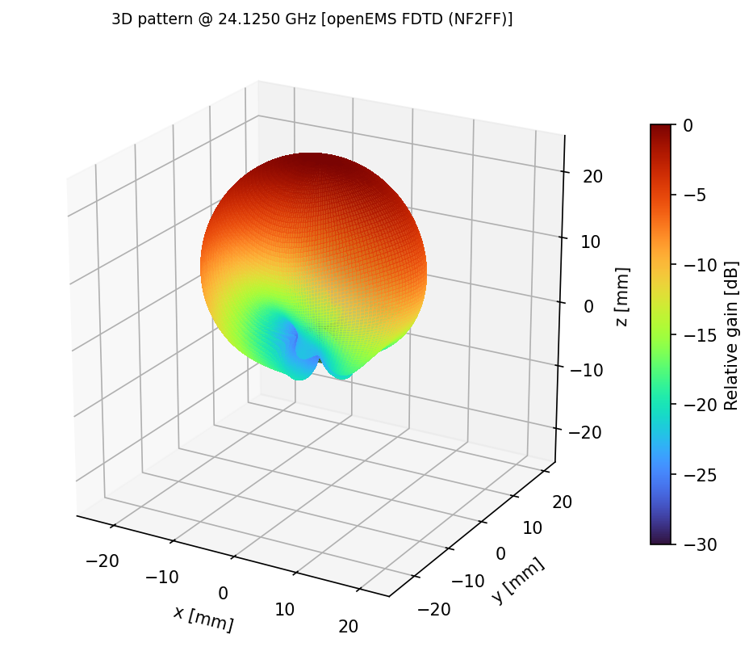
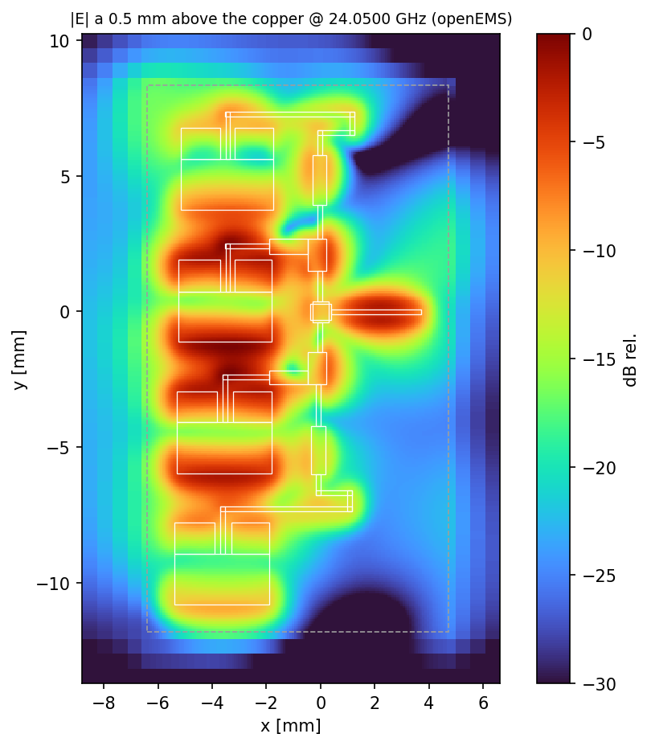
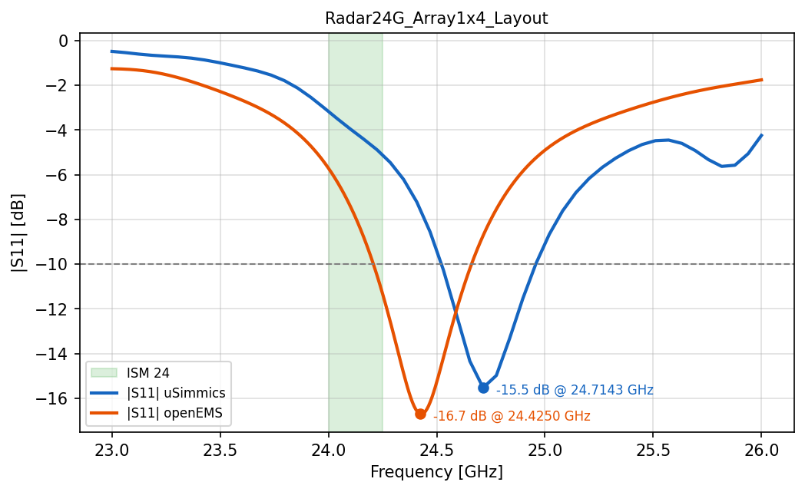
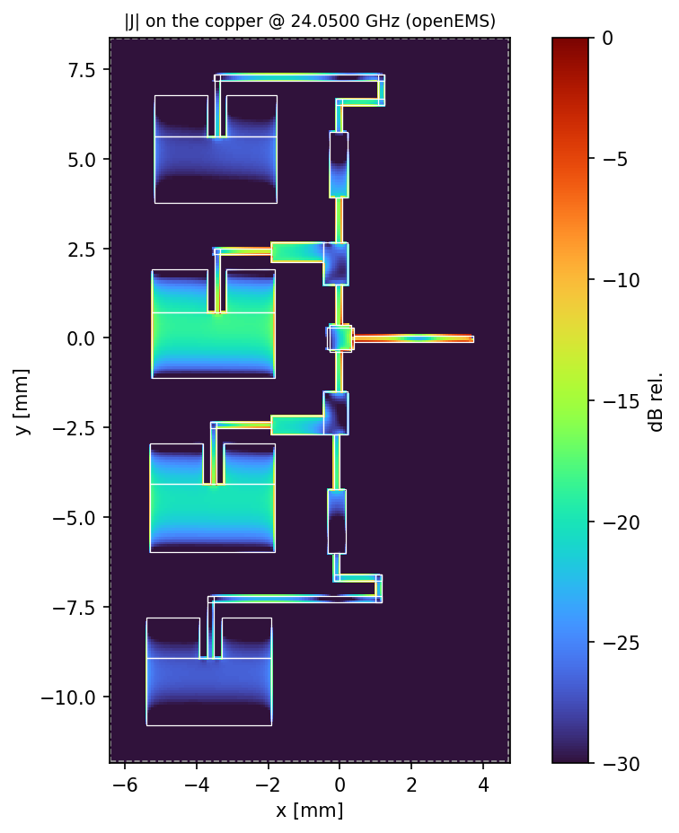
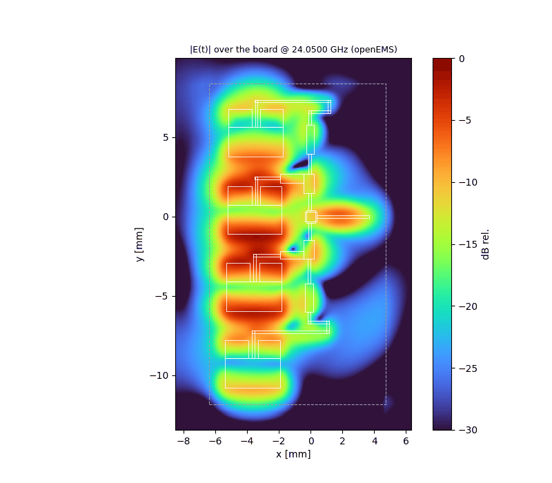
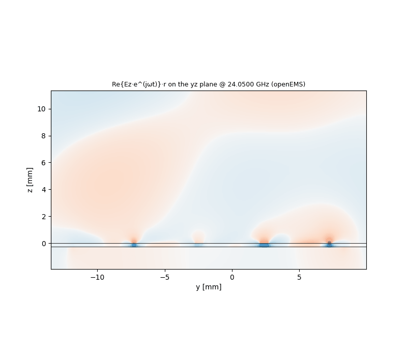

# qucs-em-viz

**Universal visualizer for uSimmics / QucsStudio EM layouts, with an optional openEMS FDTD backend.**

`qucs_em_viz.py` reads a uSimmics (formerly QucsStudio) EM layout project — the `.pcb` geometry and the binary `.dat` results — and turns it into publication-quality figures and animations: layout, S11 and Smith chart, polar cuts, a 3D radiation pattern sitting on top of the real copper, and, through openEMS, the **real near field** over the board, the surface current on the copper and the wave leaving the PCB.

It is not tied to one antenna type. Patch arrays, MIFA/IFA, printed dipoles, filters and transmission lines are all handled by the same script.

<p align="center">
  
  
</p>
<p align="center">
  
  
</p>
<p align="center">
  
  
</p>

*Example: 1×4 series/corporate patch array of the HLK-LD2411 24 GHz radar module (bundled in `examples/`).*

---

## Why

uSimmics is a great tool for distributed-element and planar EM design, but its result viewer is not made for presenting. Its `.dat` file holds S-parameters and, optionally, the far-field, but **no internal fields**. This project:

1. Parses the uSimmics files directly, with no export step and no manual copying of data.
2. Produces clean, consistent figures meant for teaching, documentation and video.
3. Optionally rebuilds the same geometry in **openEMS** (the FDTD engine uSimmics itself uses for EM layouts) to obtain what uSimmics does not export: near-field maps, surface currents and field animations.
4. Overlays the uSimmics and openEMS S11 curves, so you can check that the openEMS model really is your antenna before trusting the near-field images.

## Outputs

All files are written to `<project folder>/qucs_viz/`.

| File | Content | Needs |
|---|---|---|
| `01_layout.png` | Actual copper from the `.pcb`, ports (with impedance), lumped shorts, overall size, substrate | `.pcb` |
| `02_s11.png` + `02_s11_<source>.csv` | \|S11\| in dB, ISM bands shaded, −10 dB bandwidth; numeric export (f, S11, Zin) | `.dat` and/or openEMS |
| `03_smith.png` | S11 on a Smith chart, ISM band highlighted | idem |
| `04_cuts_polar.png` | φ = 0° and φ = 90° cuts, HPBW, directivity | a pattern source |
| `05_pattern_3d.png` | 3D pattern (dB colormap) on top of the real copper; the interactive window can be rotated with the mouse | a pattern source |
| `06_field_map_db.png`, `wave.gif` | \|E\|·r and Re{E·e^jωt} on a vertical plane (narrowest-beam plane by default) | a pattern source |
| `07_nearfield_E_top.png`, `nearfield.gif` | Real \|E\| on a plane just above the copper, static and animated | openEMS |
| `08_surface_current_J.png` | Current density \|J\| on the copper | openEMS |
| `09_nearfield_E_side.png`, `nearfield_side.gif` | \|E\|·r and the real wave Re{E·e^jωt}·r on a vertical plane | openEMS |
| `pattern_3d_rot.gif` | Rotating 3D pattern (off by default) | `MAKE_ROT_GIF = True` |

## Pattern sources

`PATTERN_SOURCE = "auto"` tries these in order:

| Source | What it is | When to use it |
|---|---|---|
| `dat` | Far-field computed by uSimmics (enable **Radiation** in the layout properties and re-simulate) | Always the preferred one if available; valid for any antenna |
| `openems` | Our own openEMS FDTD run built from the `.pcb` primitives, with NF2FF and field dumps | When you want near fields/currents, or the `.dat` has no far-field |
| `patch` | Analytical model: rectangular patch (cavity model, two radiating slots) × array factor | Quick look at patch arrays only; no mutual coupling, no feed network radiation |
| `none` | Layout and S-parameters only | — |

The field map built from a far-field (`dat` source) is only meaningful outside the near-field region, so the script masks `r < max(λ/2π, antenna size)`. Between that radius and 2D²/λ it is an approximation (Fresnel region). The real near field comes from the openEMS figures 07–09.

## Installation

```bash
pip install -r requirements.txt
```

Requirements are `numpy`, `matplotlib`, `pillow` (GIF export) and `h5py` (openEMS dumps). SciPy is **not** required.

### Optional: openEMS backend

The openEMS and CSXCAD Python bindings are not on PyPI. Install them from the [official openEMS releases](https://github.com/thliebig/openEMS-Project/releases) or build them following the [openEMS documentation](https://docs.openems.de/).

**Windows:** since Python 3.8, DLLs are no longer searched in `PATH`. The script registers the openEMS folder automatically if it finds `CSXCAD.dll` in `OE_DLL_DIR`, `%OPENEMS_INSTALL_PATH%`, `C:\openEMS` or `Program Files\openEMS`. If you get `DLL load failed while importing CSXCAD`, set:

```python
OE_DLL_DIR = r"C:\path\to\openEMS"   # folder containing openEMS.exe and CSXCAD.dll
```

## Quick start

1. Copy `qucs_em_viz.py` anywhere, or keep it in the repository.
2. Edit the `CONFIG` block at the top of the file. The script takes no command-line arguments, so it runs as-is from Thonny or any IDE:

```python
QUCS_DIR = r"C:\uSimmics\my_antenna"   # folder with the .pcb and .dat
PROJECT  = "my_antenna"                # base name of the files
```

3. Run it. Windows open with the 2D figures and an interactive 3D pattern, and everything is saved to `qucs_viz/`.

The repository ships with an example (`examples/Radar24G_Array1x4_Layout`) and is preconfigured to run it.

## Configuration

| Parameter | Default | Meaning |
|---|---|---|
| `PATTERN_SOURCE` | `"auto"` | `auto`, `dat`, `openems`, `patch`, `none` |
| `F_PATTERN_HZ` | `None` | Pattern frequency. If `None`, uses the `.pcb` Radiation frequency when it lies inside the sweep; otherwise the S11 minimum |
| `CUT_PHI_DEG` | `None` | Plane for the field maps; `None` = plane of the narrowest beam |
| `DB_RANGE` | `30` | Dynamic range of all dB plots |
| `FIELD_HALF_LAM`, `FIELD_RES_LAM` | `5`, `1/30` | Size and resolution of the far-field-based map, in λ₀ |
| `MAKE_GIFS`, `MAKE_ROT_GIF`, `N_FRAMES` | `True`, `False`, `24` | Animations |
| `SHOW`, `SHOW_WAVE_LIVE` | `True`, `True` | Interactive windows (set `SHOW = False` for batch runs) |
| `PATCH_REGEX`, `POL_AXIS`, `ELEM_PHASE_DEG`, `ELEM_AMPL` | | Analytical patch model: how patches are recognized by name (`P1_L`, `P1_R`… → `P1`), polarization axis, excitation |
| `OE_ENABLE` | `True` | Allow openEMS in `auto` mode |
| `OE_GROUND` | `"auto"` | Bottom-side ground: `"full"`, `"none"`, `"largest"` (under the largest copper rectangle) or a list of rectangles in meters. `auto` = `full` if patches are found, otherwise `none` |
| `OE_EXTRA_TOP` | `[]` | Extra top copper (e.g. the rest of the board ground) as rectangles in meters |
| `OE_RES_MM` | `None` | Fine mesh cell; `None` = half of the narrow traces, forced to at least 2 cells across every port |
| `OE_END_DB`, `OE_MAX_TS` | `-40`, `400000` | FDTD energy end criterion and timestep limit |
| `OE_AIR_LAM`, `OE_AIR_UP_LAM` | `0.25`, `1.0` | Air around the board and above it, in λ at the lowest frequency. Increase `OE_AIR_UP_LAM` to see more wave cycles in `nearfield_side.gif` (slower) |
| `OE_NEAR_DZ_MM` | `0.5` | Height of the \|E\| plane above the copper |
| `OE_N_FDUMP` | `21` | Number of frequencies stored in the field dumps |
| `OE_FORCE_RERUN` | `False` | Ignore the cache |

openEMS results are cached in `qucs_viz/openems_<hash>/`. The hash covers the `.pcb` content, the openEMS settings and the backend version, so a simulation is repeated only when something relevant changes.

## How it works

### `.pcb` (uSimmics layout, text)

- `Rectangle NAME x y dx|dy|w|h` → copper in `[x+dx, x+dx+w] × [y+dy, y+dy+h]` (meters).
- `Lumped NAME x y num dir Z … wx wy` → `num > 0` is a port with impedance `Z`; `num = 0` is a lumped element (a 0 Ω element is treated as a via to ground). The last two fields are the element width along x and along y (one of them is 0).
- `Substrate`, `Frequency` and `Radiation` properties provide εr, h, tan δ, copper thickness, the sweep, and the far-field settings.

Only `Rectangle` and `Lumped` primitives are supported at the moment. Other primitives are reported and ignored.

### `.dat` (QucsData, binary)

`"QucsData"` + 4 bytes + `int32` header length; then the header with entries `[int32 type][int32 N][name\0][dependencies\0]`; then the data blocks in the same order. Block sizes are not stored, so they are derived from the type code:

| Type | Meaning |
|---|---|
| 3 | dependent, complex (`complex128`) |
| 7 | dependent, real (`float64`) |
| 5 | independent, real (`float64`) |

For unknown codes the parser tries the possible combinations (element count × real/complex) until the total matches the file size exactly. Dependencies may carry matrix dimensions, e.g. `frequency 1 1`. Far-field variables are recognized by their axes, `theta/phi` or `azimuth/elevation`; elevation is converted with θ = 90° − elevation. Complex field components are combined as Σ\|E\|².

### openEMS model

- Substrate box with εr, h and tan δ from the `.pcb`; copper as PEC sheets at z = 0.
- **Ports:** if there is ground below the port location, a vertical lumped port (trace → bottom ground) is used, as for microstrip-fed patches. Otherwise an in-plane port spans the gap to the nearest copper, as in a MIFA feed gap.
- **Mesh:** copper and port edges are always mesh lines; nearly coincident edges (micron differences) are merged so they do not create tiny cells and an absurd timestep; at least 2 cells across each port; smooth grading to λ/20 in air; MUR boundaries.
- **Outputs:** port S11/Zin and accepted power; NF2FF far-field (full sphere, directivity, radiation efficiency); frequency-domain dumps of E above the board, J on the copper, and E on the xz/yz planes.

## Validation

**1×4 patch array, 24 GHz (`examples/`), uSimmics FDTD vs. this openEMS backend** (automatic mesh: 0.085 mm fine cell, 2.0 Mcells, −30 dB end criterion):

| | uSimmics | openEMS backend |
|---|---|---|
| S11 minimum | −15.53 dB @ 24.714 GHz | −16.71 dB @ 24.425 GHz |
| Zin at minimum | 41.6 − j13.0 Ω | 42.5 − j11.3 Ω |
| −10 dB bandwidth | 367 MHz | 443 MHz |

The ≈1.2 % resonance shift is consistent with two FDTD runs using different meshes on 0.17 mm traces; input impedance and match depth agree closely. openEMS NF2FF at 24.125 GHz: D = 10.4 dBi, HPBW 37.6° in the array plane (yz) and 78.0° in the orthogonal plane (xz). Both solvers agree that the 24.00–24.25 GHz ISM band sits on the skirt of the resonance in this model.

**Far-field parser:** a synthetic `.dat` with the exact uSimmics layout (type codes, `azimuth/elevation` axes, 81 × 41 grid) containing an ideal short dipole gives D = 1.76 dBi and HPBW = 90°, the theoretical values.

## Limitations and pitfalls

- **Substrate backside metal (the most common mistake with printed antennas).** In uSimmics the substrate can have a metal backside, which places a ground plane under the *entire* layout. That is correct for microstrip patches, but an IFA/MIFA/printed dipole over a full ground does not radiate: it becomes a shorted microstrip structure with Re(Zin) below a few ohms and an inductive Zin. The script reads this flag from the `.pcb` and warns about it. For printed antennas, remove the backside metal and draw the real board ground as copper. With `OE_GROUND = "auto"` the openEMS model follows the same flag, so both solvers simulate the same structure.
- **Schematic and layout sharing the same dataset.** With `DataSet=*.dat`, `name.sch` and `name.pcb` both write `name.dat` and overwrite each other's results. Give the EM layout its own name; the script warns when it finds a `.sch` with the same base name.
- **Matching networks drawn in the schematic** (lumped L/C) are not part of the generated layout. Design them on the EM result instead, for example by loading the EM S-parameters into a schematic.
- **Schematic-generated layouts.** A layout auto-generated from a uSimmics *schematic* of microstrip elements (MLIN, MTEE…) can look correct and still behave very differently in EM. Circuit models assume an infinite ground plane under every line and do not radiate, so a printed antenna such as a MIFA designed in the schematic is, for the circuit simulator, a meander resonator over ground. Printed antennas must be sized in the EM layout, including the real board ground.
- **Ground definition.** The `.pcb` does not fully describe the ground plane assumed by uSimmics, so the openEMS ground is set by `OE_GROUND` / `OE_EXTRA_TOP`. Always compare the two S11 curves before trusting the openEMS near-field figures.
- **Mismatched antennas.** NF2FF patterns are normalized, so they still have a shape even when almost no power enters the antenna. The script warns when S11 > −3 dB (efficiency unreliable) and when \|S11\| = 1 everywhere (port not connected to the copper).
- Multi-port S-matrix ordering inside the `.dat` has not been verified with a real file.
- Single copper layer plus an optional bottom ground; no multilayer stack-ups yet.

## Troubleshooting

| Symptom | Cause / fix |
|---|---|
| `DLL load failed while importing CSXCAD` | Set `OE_DLL_DIR` (Windows, see Installation) |
| openEMS S11 flat at 0 dB, `WARNING: port … is not connected` | Port not connected to the copper in the mesh. Reduce `OE_RES_MM` and report the case |
| `ERROR generating … (Pillow installed?)` | `pip install pillow` |
| No 3D/pattern figures | No pattern source: enable Radiation in uSimmics, or allow openEMS |
| Very long openEMS run | Increase `OE_RES_MM`, relax `OE_END_DB` to −30, reduce `OE_AIR_UP_LAM`. Results are cached after the first run |

## Credits

- [openEMS](https://openems.de/) / CSXCAD — Thorsten Liebig and contributors (FDTD engine, NF2FF).
- uSimmics / QucsStudio — Michael Margraf.
- Patch cavity model after C. A. Balanis, *Antenna Theory: Analysis and Design*, 4th ed., ch. 14.

Developed by **ELECTGPL** (electronics, RF and embedded systems channel on YouTube).
